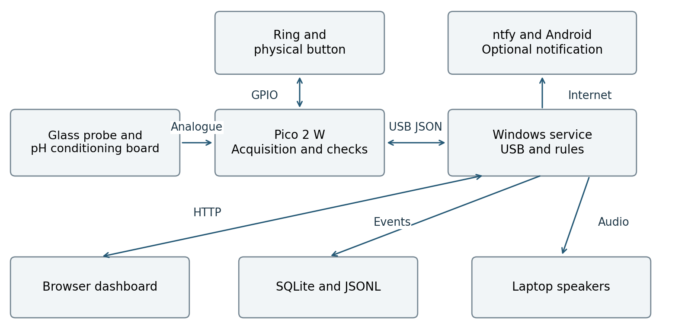
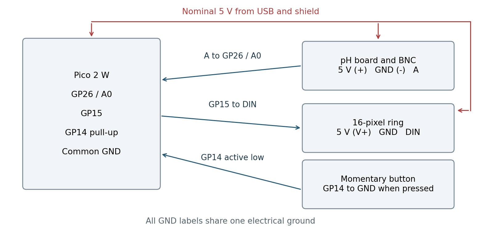
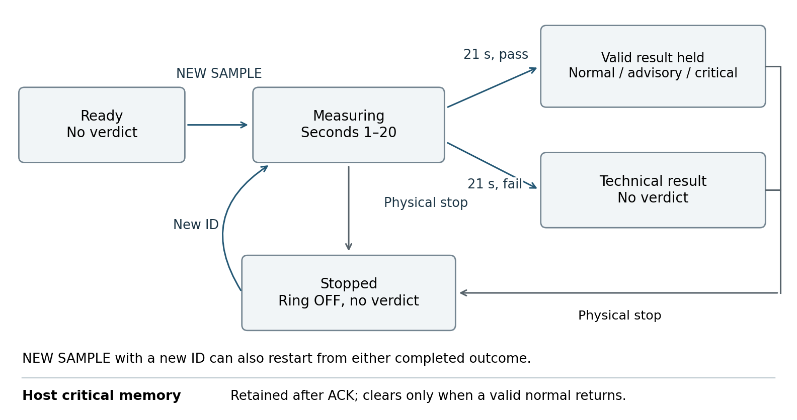
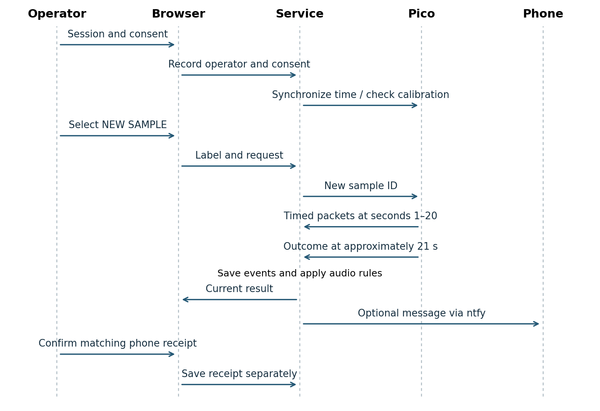

# System diagrams

## II. System architecture (Deliverable D2)

The sensing chain consists of a glass pH electrode, BNC connection and pH meter V1.1 conditioning board. The board converts the electrode response into an analogue signal read at GP26 on the Pico 2 W through the Grove shield. The Pico also controls the 16-pixel ring on GP15 and reads an active-low button on GP14. [E03, E17]

Figure 1. Implemented functional architecture. The Pico performs measurement checks. The Windows service owns serial communication, audit writes and audio. The browser is an interface to that service. Remote notification is a separate internet-dependent path. [E03, E13]

The Pico uses MicroPython rather than the CircuitPython runtime suggested in the project card. It transmits newline-delimited JSON over USB. Its wireless capability is not used for measurement transport. The service exposes a local HTTP interface at 127.0.0.1:8765 and supplies a browser display with a trace, result, calibration details and recent events.

USB provides both power and communication in the documented arrangement. Laptop audio replaces the separate PAM8302 amplifier and speaker following overheating during assembly. The failed amplifier is not counted as a working subsystem. [E01, E02]

The architecture is dependent on a functioning laptop and service. Local logging and display do not require internet, but phone messages do. The prototype has not demonstrated independent audible warning when the laptop loses power or the service stops.

### Calibration and measurement processing

The calibration script asks for nominal pH 4.00 and 7.00 liquids. It waits 60 seconds after each operator confirmation and then acquires 30 readings at one-second intervals. It rejects raw readings at or beyond 100 and 65435, separation of 500 counts or less, reversed order, or a capture spread greater than 0.95 estimated pH. It saves both complete captures, their means, operator initials, an identifier and provisional reference status. [E04]

The conversion is:

pH estimate = 4.00 + 3.00 × (raw − R4) / (R7 − R4)

R4 and R7 are the saved mean raw readings. The final archive bench-59daedbc contains stored means 31220.868 and 38102.332. Recomputed means differ by only about 0.0013 counts. Its estimated-pH spreads are 0.06278 and 0.04883, both below the configured 0.95 capture criterion. This describes within-capture variation, not independent accuracy. [E05]

| Stage | Latest implementation |
| --- | --- |
| Start | NEW_SAMPLE clears the preceding capture, filter, stability and result; duplicate delivery of the same ID does not restart it. |
| Acquire | One raw reading in each scheduled second 1-20, with a 250 ms acquisition tolerance. |
| Filter | Three-reading moving average of converted pH values. |
| Settle | Latest ten unfiltered values have range ≤0.35 pH for a ten-second dwell. |
| Evaluate | At 21 s, check calibration, completeness, signal range, pH validity, mode-specific response or drift, and settling. |
| Hold | Freeze a valid completed result; continue status and button handling without new ADC acquisition. |

## IV. System diagrams (Deliverable D4)

### Wiring and control diagrams

Figure 2. Functional wiring for the documented signal assignments. Grounds are common. The sensor-to-ADC link is shown as documented direct wiring, not as an electrically protected input. Wire colour is not used to infer a pin assignment. [E03, E17]

Figure 3. Pico sample lifecycle and the separate host critical memory. A completed valid result is held. A technical result withholds a verdict. Physical stop commands OFF; it does not erase the host’s critical history. This explains why our alarm system differs from the course.  [E03, E13]

### Sample to notification sequence

Figure 4. Routine measurement and notification sequence. The decision time starts when the Pico accepts the sample. The notification branch applies to all four completed outcomes in the revised service. [E03, E13, E23]

The service synchronizes laptop UTC with the Pico. If calibration completion has not been registered, the operator supplies the actual completion time once; that control does not perform a calibration. Each NEW SAMPLE creates a fresh identifier. Repeated requests with the same identifier do not restart the Pico timer.

With consent active, the revised service queues one submission per sample ID for an eligible result at or after 21 seconds. Measuring, idle and manually stopped samples do not send. USB loss clears the active sample and has no phone alert. All four outcomes use ntfy priority 4. The phone worker records provider acceptance or failure. The operator records receipt separately. [E23]

Communication interruption clears the host’s current sample gate. Reconnection does not convert buffered or held data into a valid new measurement. The operator must request another sample. This behaviour does not establish recovery from every power, storage or process failure; the service’s in-memory state is not reconstructed after a fresh process start.

Source [Final report PDF](EXSU620_Team4_Final_Report.pdf).
